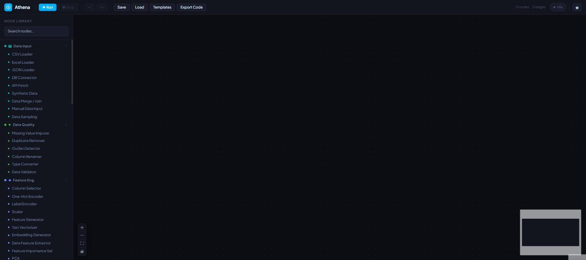
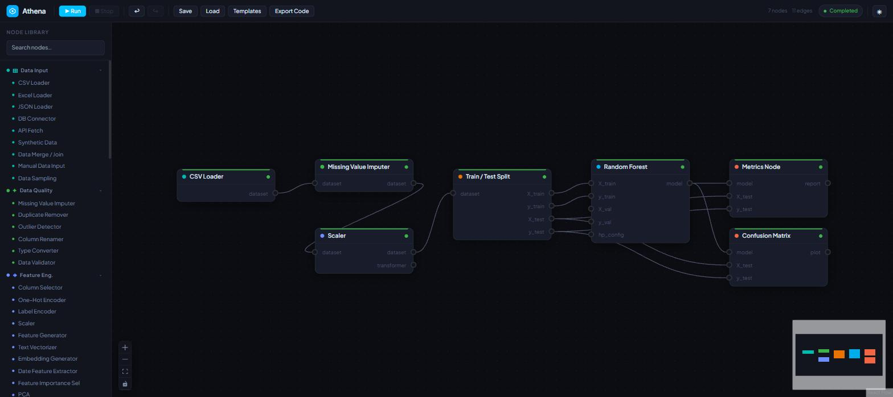
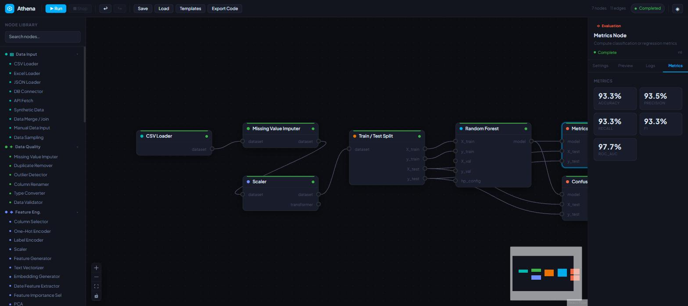
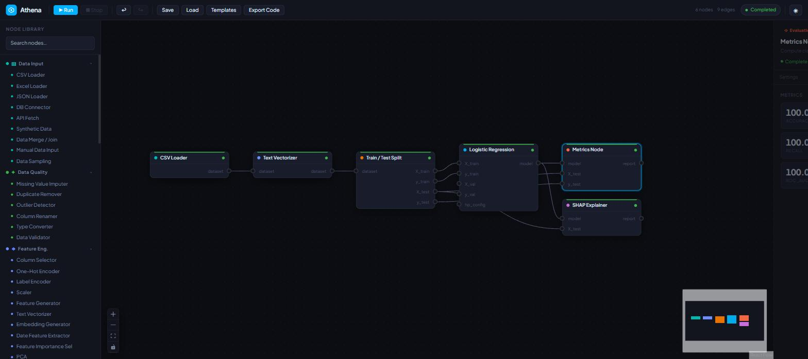

# Athena — Local No-Code AutoML Platform

A graph-based, locally-run machine learning workflow builder. Design ML pipelines visually, execute them with real Python ML libraries, inspect intermediate results, and export clean standalone code — all on your own machine with no cloud dependency.

---

## Screenshots

The canvas — drag nodes from the library on the left, wire them together, and run:



**Classification Starter** — CSV → Imputer → Scaler → Train/Test → Random Forest → Metrics + Confusion Matrix. All nodes complete and turn green:



Click any completed node to see real metrics computed by scikit-learn — no mock numbers:



**Regression Pipeline** — CSV → Imputer → Feature Gen → Train/Test → Linear Regression → Metrics + Residuals:


**NLP Pipeline** — CSV → TF-IDF Vectorizer → Train/Test → Logistic Regression → Metrics + SHAP:



---

## Prerequisites

| Tool | Version | Purpose |
|------|---------|---------|
| **Python** | 3.11 or newer | Backend runtime |
| **uv** | Latest | Python package manager |
| **Node.js** | 18 or newer | Frontend build toolchain |
| **npm** | 9 or newer | Frontend package manager |

### Install `uv` (Python package manager)

**macOS / Linux:**
```bash
curl -LsSf https://astral.sh/uv/install.sh | sh
```

**Windows (PowerShell):**
```powershell
powershell -ExecutionPolicy ByPass -c "irm https://astral.sh/uv/install.ps1 | iex"
```

Restart your terminal after installing so `uv` is on your `PATH`.

---

## Setup

### 1. Clone the repository

```bash
git clone <repo-url> athena
cd athena
```

### 2. Install root dev tools

From the project root (installs `concurrently`, which runs both servers together):

```bash
npm install
```

### 3. Install backend dependencies

```bash
cd backend
uv sync
cd ..
```

This creates a `.venv` inside `backend/` and installs all Python dependencies (FastAPI, scikit-learn, pandas, XGBoost, SHAP, matplotlib, etc.).

### 4. Install frontend dependencies

```bash
cd frontend
npm install
cd ..
```

---

## Running the app

### Start both servers at once (recommended)

From the project root:

```bash
npm run dev
```

This launches:
- **Backend** → `http://localhost:8000` (FastAPI + uvicorn, hot-reload on)
- **Frontend** → `http://localhost:5173` (Vite dev server, HMR on)

Open **`http://localhost:5173`** in your browser.

### Start servers individually

**Backend only:**
```bash
cd backend
uv run uvicorn athena.main:app --reload --port 8000
```

**Frontend only:**
```bash
cd frontend
npm run dev
```

> The frontend proxies `/api` and `/ws` to `localhost:8000`, so both must be running for the app to work.

---

## Using the app

1. **Build a pipeline** — drag nodes from the left sidebar onto the canvas, connect output ports to input ports.
2. **Configure nodes** — click any node to open the inspector panel on the right; edit settings in the Settings tab.
3. **Run** — click **Run** (or press `Ctrl/⌘ + Enter`). Nodes light up green as they execute.
4. **Inspect results** — click a completed node and switch to the **Data Preview**, **Logs**, or **Metrics** tabs. In **Data Preview**, **Profile** opens a full profile of any table output, and **↓** downloads any output (tables as CSV, models as joblib files).
   The **Code** tab shows the Python that node becomes in the export (with **Full script** for everything); Custom Code and SQL fields are code editors with syntax highlighting. **Tidy layout** (the last button in the canvas controls) arranges the nodes left to right; Ctrl+Z undoes it.
5. **Export code** — click **Export Code** in the top bar to download a standalone Python script, a Jupyter notebook (one cell per node), or the pipeline JSON. The code needs only the libraries it imports, follows your graph exactly, and is tested to produce the same results as running the pipeline in Athena. Plots are saved as PNG files next to the script.
6. **Save / Load** — click **Save** (or `Ctrl/⌘ + S`) and enter a file path. Load pipelines via `POST /api/pipelines/load` or by adding a load button (coming in v1.1).

### Connections (databases)

Click **Connections** in the top bar to save a database connection (PostgreSQL, MySQL/MariaDB, SQLite, DuckDB, SQL Server, or any SQLAlchemy URL), then use the **SQL Query** node to pull data from it.

- **Test connection** checks the settings before you save.
- Passwords are stored in your OS keychain (Windows Credential Manager, macOS Keychain, Secret Service), never in `.athena` files or exported code. You can also enter `env://VAR_NAME` to read a secret from an environment variable.
- Pipelines refer to connections by name, so you can share a pipeline without sharing credentials.
- SQLite works out of the box. Other databases need their driver: `uv pip install -e ".[postgres]"` (or `mysql`, `duckdb`, `mssql`) in `backend/`.

### Files, SQL and cloud storage

- **Parquet Loader** reads a Parquet file or a folder of Parquet files (a partitioned dataset); pick columns to read only what you need.
- **SQL Transform** runs SQL on your data with DuckDB: connected inputs are tables `in1` and `in2`, and you can query files directly (`SELECT * FROM 'data/*.parquet'`). Filter, join, aggregate, window functions.
- **Cloud File Loader** reads CSV, Parquet, JSON Lines or Excel from Amazon S3 (and S3-compatible stores such as MinIO and Cloudflare R2), Google Cloud Storage, Azure Blob / Data Lake, or a local folder. Save the bucket under **Connections → Object Storage** (with **Test connection** and a file browser); paths can be folders or globs like `sales/2026/*.parquet`. Install the driver you need: `uv sync --extra s3` (or `gcs`, `azure`). Exported code reads the same URL with pandas and takes credentials from the environment.

### SaaS apps

Pull data from **GitHub, Stripe, HubSpot, Jira, Zendesk or Shopify** without working out their endpoints and paging (`uv sync --extra api`):

1. **Connections → ＋ GitHub** (or another app): enter just what that app needs (a token; Jira and Zendesk also take your site and email; Shopify your shop name) and **Test connection**. Secrets go to your OS keychain or an `env://VAR` reference.
2. Add a **SaaS Fetch** node, choose the connection, then pick a **Resource** from the list (GitHub issues, Stripe invoices, HubSpot deals, Jira issues…). Some resources take **Parameters**, e.g. `{"owner": "dlt-hub", "repo": "dlt"}` for GitHub issues or `{"jql": "project = ABC"}` for Jira.

Each app's base URL, authentication and pagination are built in. They follow the apps' public API documentation and are tested against local mock servers, not the live services; please report any that don't work with your account. Use **API Fetch** for any other REST API.

### REST APIs

Pull JSON from any REST API with the **API Fetch** node (`uv sync --extra api`, which installs [dlt](https://dlthub.com)).

- Save the API under **Connections → REST API**: base URL, authentication (bearer token, API key in a header or query parameter, or basic auth) and any extra headers. Secrets go to your OS keychain; **Test connection** requests a path you choose.
- In the node, set the endpoint path, query parameters (JSON), and where the records are in the response (e.g. `data.items`, or leave it empty to detect).
- Pagination: *auto* (dlt detects it; check the Logs tab), *page number*, *offset*, *cursor*, *next URL* in the body, or a *Link header*. *Max pages* caps the number of requests (10 by default).
- Nested objects become columns like `address__city`; nested lists are left out and listed in the Logs tab, or keep everything as JSON with *Nested data → json*.
- dlt's anonymous telemetry is switched off, in Athena and in exported scripts.

### Subflows: reusable groups of nodes

Select a few nodes (Ctrl-click them, or Shift-drag a box around them) and press **Ctrl+G** (or the group button in the canvas controls). They become one **subflow** node; the connections that crossed the selection become its inputs and outputs. It runs, caches and exports exactly like the nodes inside it.

Click a subflow to see the nodes inside with their status and previews, rename it, **Ungroup** it to edit (Ctrl+G again to regroup), or **Save to library**. Saved subflows appear under **My subflows** at the top of the node library; drag one into any pipeline.

### Serving: deploy a model

After a run, select a model node (or Pipeline Wrapper, Calibration, Decision Threshold…), open **Preview** and press **Deploy**. Athena packages the trained model as a standalone prediction service in `~/.athena/models/<name>/`:

- `service.py` (FastAPI: `POST /predict`, `GET /schema`, `GET /health`, interactive docs at `/docs`), `model.joblib`, `schema.json` (the features, their kinds and an example request built from medians, never a real row), pinned `requirements.txt`, a `Dockerfile`, a BentoML service with `bentofile.yaml`, and a README. It runs without Athena.
- **Serving** (top bar) lists your packaged models. **Start endpoint** runs one locally (its own process, reachable only from this machine, stopped when Athena stops); the test console sends a request and shows the answer. **Download .zip** to run it elsewhere: `python service.py`, `docker build`, or `bentoml serve`.

**It takes raw rows.** The service replays the pipeline's fitted preprocessing before predicting: Missing Value Imputer, Scaler, One-Hot / Label Encoder, Type Converter, Column Renamer / Selector, Feature Generator, Date Feature Extractor, Text Vectorizer and PCA, each with exactly what it learned in training. Steps that only shape the training data (removing duplicates or outliers, sampling, SMOTE and other balancing) are skipped. Before packaging, Athena replays the chain on the training rows and checks that it reproduces the model's training features exactly; if it doesn't, or a step can't be replayed yet (e.g. Outlier Detector in clip mode, String Splitter, a merge), the Serving window names the steps requests must already reflect.

### Comparing versions

**Compare** (top bar) shows what changed on the canvas since a saved pipeline: nodes added, removed or changed (each setting's old → new value, including execution settings and changes inside subflows), connection changes and pipeline settings. **Show on canvas** tags the new and changed nodes until you press **Clear**. Nodes are matched by id, so a node whose settings changed shows as changed, not as removed and re-added.

### Re-running fast: the cache and "Run from here"

- **Unchanged nodes aren't recomputed.** When you run again, every node whose settings, upstream nodes and input files are unchanged reuses its earlier result; it shows a **cached** tag and says so in its Logs tab. Change a node and only it and the nodes after it run again; edit the CSV file and everything that depends on it re-runs.
- Nodes that write files, register models, or read from databases, APIs, cloud storage or custom code always run, since the outside world may have changed. If what they return is unchanged, the nodes after them still come from the cache. Turn **Cache** off in a node's execution settings to make it always run.
- **Run from here** (in the inspector) re-runs the selected node and everything after it, taking the nodes before it from the cache. Hover the button to see which nodes will run.
- The cache is capped by `ATHENA_CACHE_MAX_GB` and cleared when Athena stops, unless `ATHENA_KEEP_CACHE=true`.

### Dataset snapshots

The **Dataset Snapshot** node saves a Parquet copy of the table it receives, named after a hash of its contents (`training-data-3f9c1a....parquet` in `~/.athena/snapshots` or a folder you choose), and passes the table on. The same data always gives the same file, written once; any change gives a new one. Read a snapshot back with the **Parquet Loader** to reproduce a run on exactly the same data.

### Data profiling

After a run, click a node, open **Data Preview** and press **Profile** next to a table output. The profile shows:

- an overview (rows, columns by type, missing cells, duplicate rows, memory) and each column's type, missing share, unique values, distribution and summary;
- **findings**: empty or constant columns, heavy missingness, ID-like columns, high-cardinality categories, strong skew, duplicate rows, a missing or imbalanced target, and columns that look like they leak the target;
- the **target**'s distribution and which columns carry information about it (mutual information). The target is a column named `target` unless you pick another.

Tables over 100,000 rows are profiled on a random sample, and the header says so. Download the table as CSV or Parquet from the same window. Outputs are kept until Athena restarts.

### More models and smarter tuning

- **LightGBM** and **LightGBM Regressor** (included) and **CatBoost** / **CatBoost Regressor** (`uv sync --extra catboost`; handles text columns without one-hot encoding). Connect `X_val`/`y_val` and set *Early stopping rounds* to stop adding trees when validation stops improving.
- **OLS Regression** and **Logistic Regression (statsmodels)** (`uv sync --extra stats`): the classic statistical models with inference. Besides the model, they output a coefficient table (estimate, standard error, t/z statistic, p-value, 95% interval), and the Logs tab shows the full statsmodels summary. Choose *HC3* standard errors when the error variance isn't constant. The models plug into every downstream node (Metrics, Confusion Matrix, Calibration, Decision Threshold, Predict…). Features must be numeric with no missing values.
- **PR-AUC**: the Metrics node now reports average precision next to ROC AUC, and the **Precision-Recall Curve** node plots precision against recall with the no-skill baseline. On imbalanced data it is a more honest score than ROC AUC.
- **HP Tuning Config → Optuna** (`uv sync --extra optuna`): smarter search than grid or random. A value list of more than three numbers (`10-200`) is searched as a range; each trial is cross-validated and shown in the Logs tab.

### Experiment tracking and model registry (MLflow)

Install the extra once: `cd backend && uv sync --extra mlflow`. Then click **Tracking off** in the top bar to turn tracking on for the pipeline.

- Every run is logged to MLflow: each node's settings, metrics, the trained models, the pipeline file and its exported Python script.
- Runs go to Athena's built-in local store (`~/.athena/mlflow`, created on first use in about 20 seconds) or to your own MLflow server: add it under **Connections** as an *MLflow Tracking Server*.
- **Runs** shows the experiment's history. Select two or more runs to compare them side by side: best values in green, settings that differ in amber.
- The **Register Model** node registers a trained model (with an optional alias such as `champion`); **Load Registered Model** brings one back into any pipeline, by alias or version.
- To browse the local store in MLflow's own UI: `uv run mlflow ui --backend-store-uri sqlite:///$HOME/.athena/mlflow/mlflow.db`.

### Forecasting

The **Time Series** nodes work on one series: a date column and a numeric target at a regular frequency (daily, weekly, monthly, hourly...).

- **Time Series Split** sorts by date and holds out the most recent rows. It never shuffles, so the model never sees the future.
- **Forecaster** fits on the training rows and forecasts the test period, or *Horizon* steps past the end when no test set is connected. Methods:
  - *seasonal_naive*: repeats the last season. The baseline every model should beat.
  - *ets*: exponential smoothing (Holt-Winters), with additive or damped trend and additive or multiplicative seasonality.
  - *arima*: seasonal ARIMA with the orders you set.
  - *gbm_lags*: gradient boosting on lagged changes, forecasting step by step.

  It outputs the forecast table (with a prediction interval, except for *gbm_lags*) and, with a test set, MAE, RMSE, MAPE, sMAPE, MASE (below 1 beats the seasonal-naive baseline) and interval coverage. *ets* and *arima* need `uv sync --extra stats`.
- **Backtest** repeats fit-and-forecast over several cut-off dates (rolling origin) and averages the scores: a more reliable estimate than one test window.

The season length comes from the frequency (7 for daily, 12 for monthly, 52 for weekly, 24 for hourly) unless you set it. Repeated dates, missing values and gaps are reported with what to do; forecast several series by filtering to one first.

### Clustering

- **K-Means** (set *Clusters* to 0 to pick k by silhouette), **Hierarchical Clustering** and **DBSCAN** (finds clusters of any shape and marks outliers as -1) add a `cluster` column to the table. Features are the numeric columns, standardised by default so no column dominates by its units. K-Means also outputs a model that assigns new rows to clusters.
- **Cluster Evaluation** reports silhouette (higher is better), Davies-Bouldin (lower is better) and Calinski-Harabasz scores, draws the clusters on their first two principal components, and outputs a profile: each cluster's size and average feature values.

### Calibration and decision thresholds

For classifiers whose probabilities or cut-off matter (risk scores, fraud, churn):

- **Probability Calibration** makes predicted probabilities match how often the class actually occurs (sigmoid, or isotonic for larger data). Check the result with **Calibration Curve** on the test set: a reliability diagram plus the Brier score and expected calibration error.
- **Decision Threshold** picks the probability cut-off for a binary classifier: best F1 or balanced accuracy, the most recall at a minimum precision (or the reverse), or the lowest cost when a missed positive costs more than a false alarm. Its plot shows precision, recall and F1 at every threshold, and the report compares the chosen threshold with the default 0.5.

Both tune on data the model wasn't fitted on: connect `X_val`/`y_val` from **Train/Val/Test Split**, or leave them empty to use k-fold cross-validation on the training set. Never tune on the test set; evaluate on it afterwards.

### AutoML

Install the extra once: `cd backend && uv sync --extra automl` (FLAML with LightGBM and XGBoost; note that it pins XGBoost below 3.0). Then use the **AutoML Search** node, or load the **AutoML Classification** template.

- It tries several model families (LightGBM, XGBoost, random forest, extra trees, linear models, …) and their hyperparameters within a time budget, and outputs the best model, ready for the Metrics, Confusion Matrix and Register Model nodes.
- Task and metric are inferred unless you set them (ROC AUC for binary classification, log loss for multiclass, R² for regression).
- The preview is a leaderboard: each family's best validation score and how many trials it got. Progress streams to the Logs tab.
- Validation scores come from cross-validation on the training data, so they are usually a little optimistic: judge the model by the Metrics node on the test split.
- In a tracked pipeline the leaderboard and the winning configuration are logged to the run.

### Execution settings

Each node's inspector has an **Execution** section: a timeout, retries with backoff, and whether to reuse cached results. Every pipeline runs in a separate worker process, so a crashing or hung node can't take the app down, and **Stop** always works.

### Plugins

Nodes and connectors can come from separately installed Python packages. See [`docs/PLUGINS.md`](docs/PLUGINS.md); `GET /api/plugins` lists what's installed.

### Starter templates

Click **Templates** in the top bar to load a pre-built pipeline. Each template's CSV Loader node points at a small synthetic dataset that ships in `backend/`, so every template runs successfully out of the box with no setup:

| Template | Nodes | Dataset |
|----------|-------|---------|
| Classification Starter | CSV → Imputer → Scaler → Train/Test → Random Forest → Metrics + Confusion Matrix | `backend/data.csv` (300 rows, 4 features + binary `target`) |
| Regression Pipeline | CSV → Imputer → Feature Gen → Train/Test → Linear Regression → Metrics + Residuals | `backend/regression_data.csv` (300 rows, 3 numeric features + continuous `target`) |
| NLP Pipeline | CSV → TF-IDF → Train/Test → Logistic Regression → Metrics + SHAP | `backend/nlp_data.csv` (300 short review-style sentences + binary `target`) |
| AutoML Classification | CSV → Imputer → Train/Test → AutoML Search (30 s) → Metrics + Confusion Matrix | `backend/data.csv` (needs the `automl` extra) |
| Sales Forecasting | CSV → Time Series Split → ETS and a seasonal-naive baseline, plus a 4-fold Backtest | `backend/timeseries_data.csv` (two years of daily `sales`: trend, weekly and yearly seasonality; ETS needs the `stats` extra) |
| Customer Segmentation | CSV → K-Means (k chosen by silhouette) → Cluster Evaluation | `backend/customers_data.csv` (600 customers, 5 numeric features, 4 underlying segments) |

The classification, regression and NLP datasets include a handful of missing values so the Missing Value Imputer node has real work to do, and each is regenerable via the script the datasets were originally produced with (`np.random.default_rng(42)`, so results are reproducible).

---

## Running tests

### Backend

```bash
cd backend
uv run pytest
```

Expected: **43 tests passing** across DAG, executor, handlers, codegen, and API layers.

```bash
# Verbose output
uv run pytest -v

# A specific file
uv run pytest tests/test_executor.py -v
```

### Frontend

```bash
cd frontend
npm test
```

---

## Project structure

```
athena/
├── package.json          # root dev scripts (npm run dev, install:all)
│
├── frontend/             # React 18 + TypeScript + Vite
│   └── src/
│       ├── components/   # TopBar, LeftSidebar, GraphCanvas, RightSidebar, modals
│       ├── nodes/        # BaseNode custom React Flow node
│       ├── store/        # Zustand: pipelineStore, executionStore, uiStore
│       ├── hooks/        # useRunPipeline, useAutosave, useTheme, useKeyboardShortcuts
│       ├── lib/          # api client, WebSocket client, DAG utils, validation
│       ├── registry/     # nodeRegistry.ts — single source of truth for node UI metadata
│       └── types/        # TypeScript types mirroring backend Pydantic schemas
│
└── backend/              # FastAPI + Python ML stack
    ├── athena/
    │   ├── api/          # REST routes: /api/pipelines, /api/runs, /api/nodes
    │   ├── core/         # DAG executor, registry, cache, event broker, codegen
    │   ├── nodes/        # ML node handlers (data, quality, feature, model, eval, deploy…)
    │   ├── schemas/      # Pydantic models for pipeline, events, artifacts
    │   ├── storage/      # .athena file save/load, autosave rotation
    │   └── utils/        # DataFrame previews, matplotlib → base64, logging
    └── tests/            # pytest suite
```

---

## Configuration

All backend settings are environment variables prefixed `ATHENA_`:

| Variable | Default | Description |
|----------|---------|-------------|
| `ATHENA_HOST` | `127.0.0.1` | Bind address (keep as-is; see security note below) |
| `ATHENA_PORT` | `8000` | Backend port |
| `ATHENA_DATA_DIR` | `~/.athena` | Cache, autosave, and settings root |
| `ATHENA_NODE_TIMEOUT_S` | `300` | Per-node soft timeout in seconds |
| `ATHENA_CACHE_MAX_GB` | `2` | Size limit of the node-result cache; the least recently used results are dropped first |
| `ATHENA_KEEP_CACHE` | `false` | Keep cached node results when Athena restarts (otherwise the cache is cleared on exit) |
| `ATHENA_LOG_LEVEL` | `INFO` | structlog level |
| `ATHENA_ALLOW_CUSTOM_CODE` | `true` | Set to `false` to disable the Custom Code node |

Example — raise the node timeout:

```bash
ATHENA_NODE_TIMEOUT_S=600 uv run uvicorn athena.main:app --reload --port 8000
```

---

## Keyboard shortcuts

| Shortcut | Action |
|----------|--------|
| `Ctrl/⌘ + Enter` | Run pipeline |
| `Ctrl/⌘ + Z` | Undo |
| `Ctrl/⌘ + Shift + Z` | Redo |
| `Ctrl/⌘ + S` | Save pipeline |
| `Delete / Backspace` | Remove selected node or edge |
| `Esc` | Deselect all |

---

## Autosave & recovery

The app autosaves your pipeline to `~/.athena/autosave/latest.athena` every 10 seconds when there are unsaved changes. On next launch, if the autosave differs from the default starter pipeline, Athena automatically restores it and shows a notification.

Up to 5 rotated autosave snapshots are kept (`autosave-1.athena` … `autosave-5.athena`).

---

## Data files

Node file paths (e.g. in the **CSV Loader**) are resolved relative to the directory where you started uvicorn. Use absolute paths to be safe:

```
/Users/you/datasets/iris.csv        # macOS / Linux
C:\Users\you\datasets\iris.csv      # Windows
```

---

## Security note

Athena binds to `127.0.0.1` by default and is intended for **single-user, local use only**. Do not set `ATHENA_HOST=0.0.0.0` unless you understand the implications — the backend exposes your local filesystem and can execute arbitrary Python via the Custom Code node.

---

## Troubleshooting

**"Couldn't reach the backend" toast on Run**
- Make sure `uvicorn` is running on port 8000.
- Check the terminal for Python import errors on startup.

**Frontend shows a blank page**
- Open browser devtools console for errors.
- Confirm `npm run dev` is running and the Vite server is on port 5173.

**`uv: command not found`**
- Re-open your terminal after installing uv, or run `source ~/.bashrc` / `source ~/.zshrc`.

**Port 8000 already in use**
```bash
# macOS / Linux
lsof -i :8000 | grep LISTEN
kill -9 <PID>

# Windows PowerShell
netstat -ano | findstr :8000
Stop-Process -Id <PID> -Force
```

**Python version mismatch**
- Athena requires Python 3.11+. Check with `python --version` or `python3 --version`.
- `uv` will automatically use the right version if you have it installed; otherwise install Python 3.11 from [python.org](https://www.python.org/downloads/).
