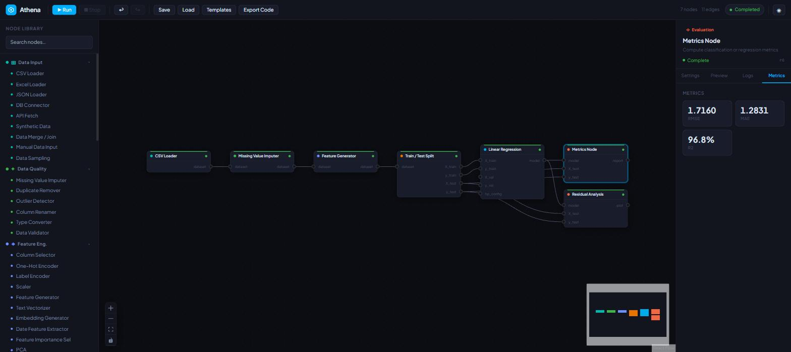

# Athena — Local No-Code AutoML Platform

A graph-based, locally-run machine learning workflow builder. Design ML pipelines visually, execute them with real Python ML libraries, inspect intermediate results, and export clean standalone code — all on your own machine with no cloud dependency.

---

## Screenshots

The canvas — drag nodes from the library on the left, wire them together, and run:


**Classification Starter** — CSV → Imputer → Scaler → Train/Test → Random Forest → Metrics + Confusion Matrix. All nodes complete and turn green:


Click any completed node to see real metrics computed by scikit-learn — no mock numbers:


**Regression Pipeline** — CSV → Imputer → Feature Gen → Train/Test → Linear Regression → Metrics + Residuals:



**NLP Pipeline** — CSV → TF-IDF Vectorizer → Train/Test → Logistic Regression → Metrics + SHAP:


---

## Prerequisites

| Tool | Version | Purpose |
|------|---------|---------|
| **Python** | 3.11 or newer | Backend runtime |
| **uv** | Latest | Python package manager |
| **Node.js** | 18 or newer | Frontend build toolchain |
| **npm** | 9 or newer | Frontend package manager |

### Install `uv` (Python package manager)

**macOS / Linux:**
```bash
curl -LsSf https://astral.sh/uv/install.sh | sh
```

**Windows (PowerShell):**
```powershell
powershell -ExecutionPolicy ByPass -c "irm https://astral.sh/uv/install.ps1 | iex"
```

Restart your terminal after installing so `uv` is on your `PATH`.

---

## Setup

### 1. Clone the repository

```bash
git clone <repo-url> athena
cd athena
```

### 2. Install root dev tools

From the project root (installs `concurrently`, which runs both servers together):

```bash
npm install
```

### 3. Install backend dependencies

```bash
cd backend
uv sync
cd ..
```

This creates a `.venv` inside `backend/` and installs all Python dependencies (FastAPI, scikit-learn, pandas, XGBoost, SHAP, matplotlib, etc.).

### 4. Install frontend dependencies

```bash
cd frontend
npm install
cd ..
```

---

## Running the app

### Start both servers at once (recommended)

From the project root:

```bash
npm run dev
```

This launches:
- **Backend** → `http://localhost:8000` (FastAPI + uvicorn, hot-reload on)
- **Frontend** → `http://localhost:5173` (Vite dev server, HMR on)

Open **`http://localhost:5173`** in your browser.

### Start servers individually

**Backend only:**
```bash
cd backend
uv run uvicorn athena.main:app --reload --port 8000
```

**Frontend only:**
```bash
cd frontend
npm run dev
```

> The frontend proxies `/api` and `/ws` to `localhost:8000`, so both must be running for the app to work.

---

## Using the app

1. **Build a pipeline** — drag nodes from the left sidebar onto the canvas, connect output ports to input ports.
2. **Configure nodes** — click any node to open the inspector panel on the right; edit settings in the Settings tab.
3. **Run** — click **Run** (or press `Ctrl/⌘ + Enter`). Nodes light up green as they execute.
4. **Inspect results** — click a completed node and switch to the **Data Preview**, **Logs**, or **Metrics** tabs.
5. **Export code** — click **Export Code** in the top bar to download a standalone Python script, Jupyter notebook, or pipeline JSON.
6. **Save / Load** — click **Save** (or `Ctrl/⌘ + S`) and enter a file path. Load pipelines via `POST /api/pipelines/load` or by adding a load button (coming in v1.1).

### Starter templates

Click **Templates** in the top bar to load a pre-built pipeline. Each template's CSV Loader node points at a small synthetic dataset that ships in `backend/`, so every template runs successfully out of the box with no setup:

| Template | Nodes | Dataset |
|----------|-------|---------|
| Classification Starter | CSV → Imputer → Scaler → Train/Test → Random Forest → Metrics + Confusion Matrix | `backend/data.csv` (300 rows, 4 features + binary `target`) |
| Regression Pipeline | CSV → Imputer → Feature Gen → Train/Test → Linear Regression → Metrics + Residuals | `backend/regression_data.csv` (300 rows, 3 numeric features + continuous `target`) |
| NLP Pipeline | CSV → TF-IDF → Train/Test → Logistic Regression → Metrics + SHAP | `backend/nlp_data.csv` (300 short review-style sentences + binary `target`) |

All three datasets include a handful of missing values so the Missing Value Imputer node has real work to do, and each is regenerable via the script the datasets were originally produced with (`np.random.default_rng(42)`, so results are reproducible).

---

## Running tests

### Backend

```bash
cd backend
uv run pytest
```

Expected: **43 tests passing** across DAG, executor, handlers, codegen, and API layers.

```bash
# Verbose output
uv run pytest -v

# A specific file
uv run pytest tests/test_executor.py -v
```

### Frontend

```bash
cd frontend
npm test
```

---

## Project structure

```
athena/
├── package.json          # root dev scripts (npm run dev, install:all)
│
├── frontend/             # React 18 + TypeScript + Vite
│   └── src/
│       ├── components/   # TopBar, LeftSidebar, GraphCanvas, RightSidebar, modals
│       ├── nodes/        # BaseNode custom React Flow node
│       ├── store/        # Zustand: pipelineStore, executionStore, uiStore
│       ├── hooks/        # useRunPipeline, useAutosave, useTheme, useKeyboardShortcuts
│       ├── lib/          # api client, WebSocket client, DAG utils, validation
│       ├── registry/     # nodeRegistry.ts — single source of truth for node UI metadata
│       └── types/        # TypeScript types mirroring backend Pydantic schemas
│
└── backend/              # FastAPI + Python ML stack
    ├── athena/
    │   ├── api/          # REST routes: /api/pipelines, /api/runs, /api/nodes
    │   ├── core/         # DAG executor, registry, cache, event broker, codegen
    │   ├── nodes/        # ML node handlers (data, quality, feature, model, eval, deploy…)
    │   ├── schemas/      # Pydantic models for pipeline, events, artifacts
    │   ├── storage/      # .athena file save/load, autosave rotation
    │   └── utils/        # DataFrame previews, matplotlib → base64, logging
    └── tests/            # pytest suite
```

---

## Configuration

All backend settings are environment variables prefixed `ATHENA_`:

| Variable | Default | Description |
|----------|---------|-------------|
| `ATHENA_HOST` | `127.0.0.1` | Bind address (keep as-is; see security note below) |
| `ATHENA_PORT` | `8000` | Backend port |
| `ATHENA_DATA_DIR` | `~/.athena` | Cache, autosave, and settings root |
| `ATHENA_NODE_TIMEOUT_S` | `300` | Per-node soft timeout in seconds |
| `ATHENA_CACHE_MAX_GB` | `2` | Artifact cache eviction threshold |
| `ATHENA_LOG_LEVEL` | `INFO` | structlog level |
| `ATHENA_ALLOW_CUSTOM_CODE` | `true` | Set to `false` to disable the Custom Code node |

Example — raise the node timeout:

```bash
ATHENA_NODE_TIMEOUT_S=600 uv run uvicorn athena.main:app --reload --port 8000
```

---

## Keyboard shortcuts

| Shortcut | Action |
|----------|--------|
| `Ctrl/⌘ + Enter` | Run pipeline |
| `Ctrl/⌘ + Z` | Undo |
| `Ctrl/⌘ + Shift + Z` | Redo |
| `Ctrl/⌘ + S` | Save pipeline |
| `Delete / Backspace` | Remove selected node or edge |
| `Esc` | Deselect all |

---

## Autosave & recovery

The app autosaves your pipeline to `~/.athena/autosave/latest.athena` every 10 seconds when there are unsaved changes. On next launch, if the autosave differs from the default starter pipeline, Athena automatically restores it and shows a notification.

Up to 5 rotated autosave snapshots are kept (`autosave-1.athena` … `autosave-5.athena`).

---

## Data files

Node file paths (e.g. in the **CSV Loader**) are resolved relative to the directory where you started uvicorn. Use absolute paths to be safe:

```
/Users/you/datasets/iris.csv        # macOS / Linux
C:\Users\you\datasets\iris.csv      # Windows
```

---

## Security note

Athena binds to `127.0.0.1` by default and is intended for **single-user, local use only**. Do not set `ATHENA_HOST=0.0.0.0` unless you understand the implications — the backend exposes your local filesystem and can execute arbitrary Python via the Custom Code node.

---

## Troubleshooting

**"Couldn't reach the backend" toast on Run**
- Make sure `uvicorn` is running on port 8000.
- Check the terminal for Python import errors on startup.

**Frontend shows a blank page**
- Open browser devtools console for errors.
- Confirm `npm run dev` is running and the Vite server is on port 5173.

**`uv: command not found`**
- Re-open your terminal after installing uv, or run `source ~/.bashrc` / `source ~/.zshrc`.

**Port 8000 already in use**
```bash
# macOS / Linux
lsof -i :8000 | grep LISTEN
kill -9 <PID>

# Windows PowerShell
netstat -ano | findstr :8000
Stop-Process -Id <PID> -Force
```

**Python version mismatch**
- Athena requires Python 3.11+. Check with `python --version` or `python3 --version`.
- `uv` will automatically use the right version if you have it installed; otherwise install Python 3.11 from [python.org](https://www.python.org/downloads/).
